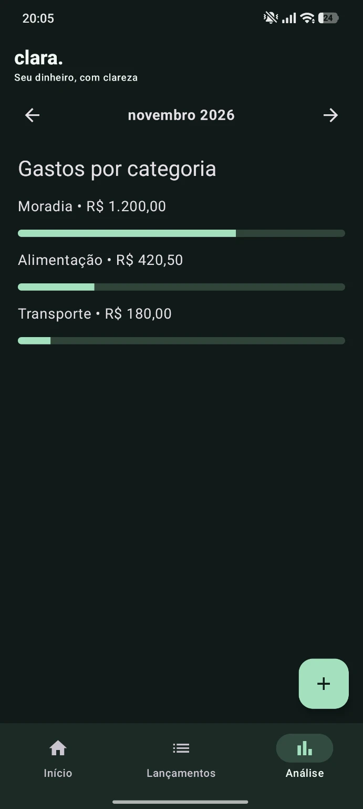

# Clara Finanças 📱

Aplicativo **Android nativo de gestão de finanças pessoais** desenvolvido com Kotlin e Jetpack Compose.

> **Status:** MVP inicial em evolução. Compilação Android e testes unitários aprovados no [GitHub Actions](https://github.com/earaujorfl/clara-financas-android/actions/runs/44959168817) em 21/11/2026. O APK de depuração está disponível como artefato dessa execução; a instalação em dispositivo Android real e a conferência visual das três abas foram realizadas com lançamentos de demonstração em 21/11/2026. Os testes instrumentados de interface ainda estão pendentes.

## Funcionalidades

- 💰 Cadastro de **receitas e despesas** em reais (BRL).
- 📊 Saldo mensal, resumo financeiro e gastos por categoria.
- 🧾 Listagem de lançamentos e exclusão com confirmação.
- 🗓 Navegação entre meses.
- 🔒 Dados armazenados localmente com **Room**, sem login ou conexão com servidor.
- ✅ Cálculos com valores inteiros em **centavos (Long)**, sem erros típicos de ponto flutuante.

## Stack

| Camada | Tecnologias |
| --- | --- |
| Linguagem | Kotlin |
| Interface | Jetpack Compose + Material 3 |
| Arquitetura | MVVM, Repository, Flow |
| Persistência | Room (SQLite) |
| Qualidade | JUnit + GitHub Actions |
| Plataforma | Android API 26+ |

## Rodar localmente

1. Clone: `git clone https://github.com/earaujorfl/clara-financas-android.git`
2. Abra a pasta no Android Studio.
3. Instale **Android SDK 36** e selecione **JDK 17**.
4. Sincronize o Gradle e execute o módulo `app` em um emulador ou dispositivo Android.

**Nota sobre Gradle:** esta primeira versão fornece as propriedades de distribuição em `gradle/wrapper/gradle-wrapper.properties`, mas ainda não contém `gradlew`, `gradlew.bat` e `gradle-wrapper.jar`. Instale Gradle 8.13 e rode `gradle wrapper --gradle-version 8.13` para gerá-los. Enquanto isso, a CI usa Gradle 8.13 instalado diretamente.

## Organização do código

```text
app/src/main/java/com/portfolio/clara/
├── MainActivity.kt
├── data/          # Entity, DAO, Room e Repository
├── domain/        # Cálculo de saldo e conversão BRL
└── ui/            # Compose e ViewModel
```

Consulte [Arquitetura](docs/ARQUITETURA.md) e [Roadmap](docs/ROADMAP.md).

## Build de teste

A versão com os ajustes de interface foi compilada e testada na [Android CI #5](https://github.com/earaujorfl/clara-financas-android/actions/runs/44959168817). Abra a execução, localize **Artifacts** e baixe `clara-debug-apk`. Extraia o ZIP para obter o APK de depuração. É um build de desenvolvimento, não uma versão assinada de distribuição.

## Capturas de tela

Imagens reais do Clara Finanças em um dispositivo Android, registradas com **dados fictícios** em novembro de 2026.

<table>
  <thead><tr><th>Início</th><th>Lançamentos</th><th>Análise</th></tr></thead>
  <tbody>
    <tr>
      <td></td>
      <td></td>
      <td></td>
    </tr>
  </tbody>
</table>

> O aplicativo foi instalado e inspecionado em dispositivo Android real. A validação automatizada de interface ainda está planejada.

## Privacidade

O MVP não requer permissão de internet, desativa backup automático e mantém os dados no dispositivo. Não utiliza criptografia adicional de banco de dados.

## Próximos passos

Melhorias planejadas: edição de lançamentos, categorias personalizadas, limites de gastos, exportação CSV, testes de UI e screenshots reais.

## Licença

MIT — veja [LICENSE](LICENSE).