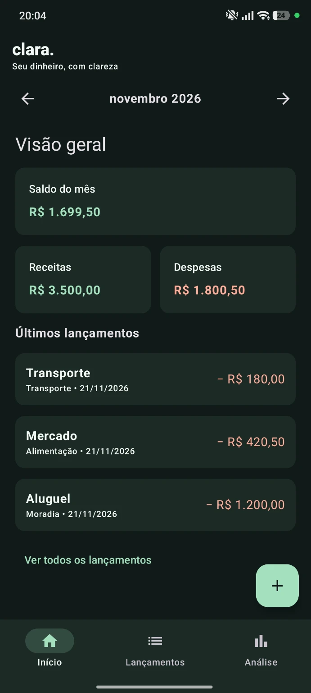
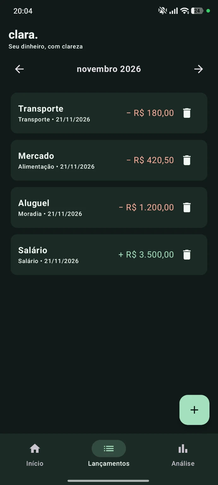

# Clara Finanças 📱

Aplicativo **Android nativo de gestão de finanças pessoais** desenvolvido com Kotlin e Jetpack Compose.

> **Status:** MVP inicial em evolução. Compilação Android e testes unitários aprovados no [GitHub Actions](https://github.com/earaujorfl/clara-financas-android/actions/runs/44965648134) em 21/11/2026. O APK de depuração está disponível como artefato dessa execução; a instalação em dispositivo Android real e a conferência visual das três abas foram realizadas com lançamentos de demonstração em 21/11/2026. Os testes instrumentados de interface ainda estão pendentes.

## Funcionalidades

- 💰 Cadastro de **receitas e despesas** em reais (BRL).
- 📊 Saldo mensal, resumo financeiro e gastos por categoria.
- 🧾 Listagem, edição e exclusão de lançamentos com confirmação.
- 🔎 Busca por descrição/categoria (ignora maiúsculas e acentos), filtro por tipo e categoria no histórico do mês.
- 🏷️ Categorias personalizadas de receitas e despesas, salvas no dispositivo.
- 📅 Escolha da data de receitas e despesas, com atualização automática do mês exibido.
- 🗓 Navegação entre meses.
- 🔒 Dados armazenados localmente com **Room**, sem login ou conexão com servidor.
- ✅ Cálculos com valores inteiros em **centavos (Long)**, sem erros típicos de ponto flutuante.

## Stack

| Camada | Tecnologias |
| --- | --- |
| Linguagem | Kotlin |
| Interface | Jetpack Compose + Material 3 |
| Arquitetura | MVVM, Repository, Flow |
| Persistência | Room (SQLite) |
| Qualidade | JUnit + GitHub Actions |
| Plataforma | Android API 26+ |

## Rodar localmente

1. Clone: `git clone https://github.com/earaujorfl/clara-financas-android.git`
2. Abra a pasta no Android Studio.
3. Instale **Android SDK 36** e selecione **JDK 17**.
4. Sincronize o Gradle e execute o módulo `app` em um emulador ou dispositivo Android.

**Nota sobre Gradle:** esta primeira versão fornece as propriedades de distribuição em `gradle/wrapper/gradle-wrapper.properties`, mas ainda não contém `gradlew`, `gradlew.bat` e `gradle-wrapper.jar`. Instale Gradle 8.13 e rode `gradle wrapper --gradle-version 8.13` para gerá-los. Enquanto isso, a CI usa Gradle 8.13 instalado diretamente.

## Organização do código

```text
app/src/main/java/com/portfolio/clara/
├── MainActivity.kt
├── data/          # Entity, DAO, Room e Repository
├── domain/        # Cálculo de saldo e conversão BRL
└── ui/            # Compose e ViewModel
```

Consulte [Arquitetura](docs/ARQUITETURA.md) e [Roadmap](docs/ROADMAP.md).

## Cadastro e edição

Na aba **Lançamentos**, toque no ícone de lápis para editar descrição, valor, tipo, categoria ou data. Para adicionar um novo lançamento, toque em **+** e escolha a data pelo calendário. Se o lançamento mudar de mês, a tela passa a mostrar o mês de destino. A edição mantém o identificador original no banco Room, sem recriar o registro e sem exigir migração do schema.

## Busca, filtros e categorias (v0.3.0)

- Na aba **Lançamentos**, pesquise por texto, selecione **Todos / Receitas / Despesas** e use o seletor de categoria. Os filtros atuam apenas sobre o histórico do mês; os totais do dashboard continuam mostrando **todos** os lançamentos.
- Ao criar ou editar uma receita/despesa, toque em **Nova categoria**. Escolha um nome distinto (máximo de 40 caracteres). Categorias criadas aparecem nos próximos cadastros do mesmo tipo.
- As categorias padrão continuam disponíveis; a exclusão ou renomeação de categorias personalizadas ainda não faz parte desta versão.
- O banco Room agora usa o esquema **v2**, com uma migração explícita **1 → 2** que adiciona a tabela de categorias e preserva os lançamentos existentes. **Não é necessário limpar o banco de dados para atualizar o schema.**

## Build de teste

A versão **0.3.0** teve compilação e testes unitários aprovados na [Android CI #9](https://github.com/earaujorfl/clara-financas-android/actions/runs/44965648134). Os testes de interface e de migração **em um emulador com banco de dados v1** ainda estão pendentes. Abra a execução, localize **Artifacts** e baixe `clara-debug-apk`. Extraia o ZIP para obter o APK de depuração. É um build de desenvolvimento, não uma versão assinada de distribuição.

**Atualização de versões de teste:** APKs de debug de execuções diferentes podem usar assinaturas diferentes. Se o Android impedir a atualização, será necessário remover a versão anterior antes de instalar esta. **Desinstalar apaga o banco local do aplicativo** — use apenas dados fictícios até existir um mecanismo de backup.

## Capturas de tela

Imagens reais do Clara Finanças em um dispositivo Android, registradas com **dados fictícios** em novembro de 2026.

<table>
  <thead><tr><th>Início</th><th>Lançamentos</th><th>Análise</th></tr></thead>
  <tbody>
    <tr>
      <td></td>
      <td></td>
      <td></td>
    </tr>
  </tbody>
</table>

> O aplicativo foi instalado e inspecionado em dispositivo Android real. A validação automatizada de interface ainda está planejada.

## Privacidade

O MVP não requer permissão de internet, desativa backup automático e mantém os dados no dispositivo. Não utiliza criptografia adicional de banco de dados.

## Próximos passos

Melhorias planejadas: renomear/remover categorias personalizadas, limites de gastos, exportação CSV, testes de migração e testes instrumentados de UI.

## Licença

MIT — veja [LICENSE](LICENSE).